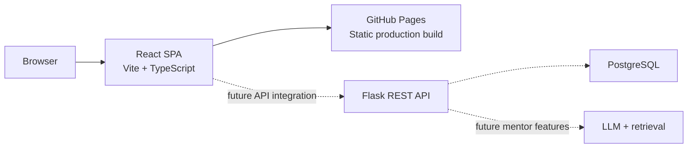

# ExamMate AI Architecture

## Product

ExamMate AI is a student-focused platform for learning software development, practicing coding, building projects, preparing for interviews, and tracking placement progress.

## Current implementation

The **only frontend** is a React single-page application in `frontend-react/`. It is built with React 18, TypeScript, Vite, Tailwind CSS, and React Router 6. The current app contains the public pages and student dashboard views listed below.

There is no backend, database, production authentication, or AI integration yet. Login, registration, and dashboard data are frontend/demo experiences until those systems are built.



## Frontend routes

| Route | Page |
| --- | --- |
| `/` | Home |
| `/about` | About |
| `/login` | Login |
| `/register` | Registration |
| `/dashboard` | Student dashboard |
| `/career-paths` | Career paths |
| `/learn` | Learning hub |
| `/practice` | Coding practice |
| `/projects` | Projects |
| `/placement` | Placement preparation |
| `/assessment` | Assessments |
| `/performance` | Progress and performance |
| `/profile` | Profile settings |
| `/contact` | Contact |

The dashboard's responsive layout and views are implemented in `frontend-react/src/pages/DashboardPage.tsx` and `frontend-react/src/components/dashboard/`.

## Technology

| Layer | Current or planned technology |
| --- | --- |
| Frontend | React 18, TypeScript, Vite, Tailwind CSS, React Router 6 |
| Backend (planned) | Python, Flask, REST API |
| Database (planned) | PostgreSQL |
| AI (planned) | LLM API with retrieval-augmented generation (RAG) |

## Repository layout

```text
.
├── .github/workflows/main.yml   # GitHub Pages build and deployment
├── docs/architecture.md         # This document
└── frontend-react/
    ├── public/                  # Static images and icons
    └── src/
        ├── components/          # Shared UI and dashboard views
        ├── pages/               # Route-level screens
        └── types/               # Shared TypeScript types
```

## Local development

Run these commands from the repository root:

```bash
cd frontend-react
npm ci
npm run dev
```

Vite prints the local URL, normally `http://localhost:5173/`. Use Vite rather than a static “Go Live” server because the app uses TypeScript and JSX modules.

Build and type-check the production app with:

```bash
npm run build
```

## GitHub Pages deployment

The workflow in `.github/workflows/main.yml` runs on pushes to `main` and manual dispatch:

1. Installs the frontend dependencies with `npm ci`.
2. Reads the Pages base path from `actions/configure-pages` and passes it to Vite.
3. Builds the React app and copies `dist/index.html` to `dist/404.html` for client-side route fallback.
4. Publishes `frontend-react/dist`.

`BrowserRouter` and public asset URLs use Vite's `BASE_URL`, so both a repository subpath and a custom Pages domain are supported.

## Planned service architecture

When backend work begins, the browser app will call a Flask REST API. The API will own authentication, authorization, validation, and persistence; secrets must remain server-side.

Planned service areas:

- **Accounts and profiles:** registration, login, student profile, and career goals.
- **Learning and career paths:** roadmaps, resources, and student progress.
- **Practice and assessments:** questions, attempts, timed tests, and results.
- **Analytics:** accuracy, milestones, and areas to review.
- **AI mentor:** contextual hints, recommendations, and evaluation using approved learning content.

PostgreSQL is the planned relational database. A vector-search extension may be added if the AI mentor requires retrieval over course materials. Neither the database nor API is implemented yet.

## Development roadmap

1. **Product foundation:** architecture, design system, React frontend, and core experience.
2. **Functional platform:** authentication, student profiles, learning paths, practice, projects, and progress.
3. **Backend and database:** Flask APIs, PostgreSQL, authorization, and data management.
4. **AI integration:** ExamMate AI Mentor, personalized recommendations, and AI-based evaluation.
5. **Business features:** subscriptions, payments, usage limits, and admin tools.
6. **Launch:** beta testing, feedback, performance improvements, and public launch.

