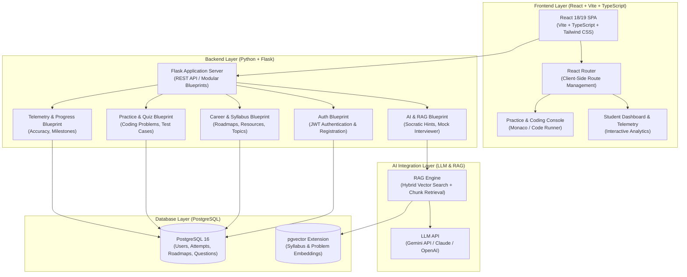
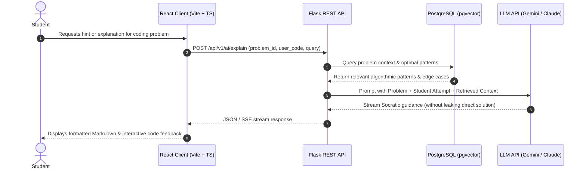
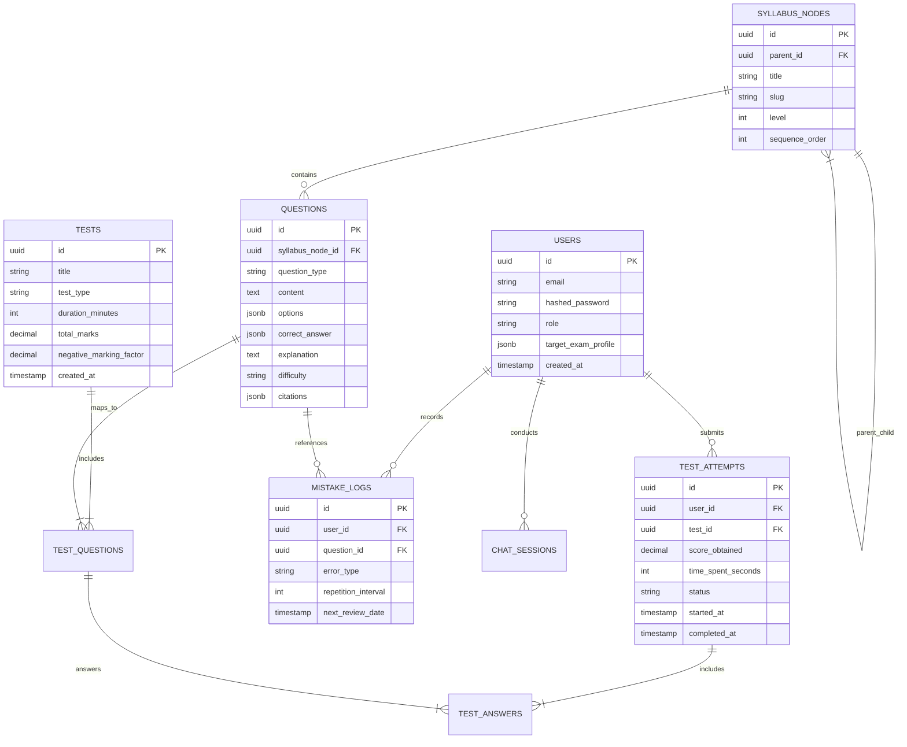

# System Architecture & Technical Design — ExamMate AI

## 1. High-Level Architecture Overview

The **ExamMate AI** platform employs a modern decoupled architecture featuring a high-performance **Vite + React SPA**, a lightweight **Python/Flask REST API**, a relational **PostgreSQL** database, and an **LLM + RAG** intelligence layer.

---

## 2. Tech Stack Specification

| Component | Technology | Rationale |
| :--- | :--- | :--- |
| **Frontend Framework** | **React + TypeScript + Vite** | Instant HMR, ultra-fast build times, typed safety, modern component-driven development. |
| **Routing** | **React Router (v6/v7)** | Robust client-side routing across all platform modules (`/`, `/learn`, `/practice`, `/dashboard`, etc.). |
| **Styling & Design System**| **Tailwind CSS** | Utility-first styling mapping directly to our Royal Purple (`#5B3CE8`) and Dark Navy (`#120E2C`) tokens. |
| **Backend Framework** | **Python + Flask (REST API)** | Lightweight, highly readable, modular blueprints; direct compatibility with Python data science & AI libraries. |
| **Database** | **PostgreSQL 16** | ACID-compliant relational storage for user accounts, progress, question banks, and job trackers. |
| **Vector Extension** | **pgvector** | Seamless vector similarity search integrated directly inside PostgreSQL for RAG pipelines. |
| **AI Integration** | **LLM API + RAG** | Socratic explanations, code review hints, and realistic HR/technical mock interview evaluations. |

---

## 3. RAG Pipeline Architecture

---

## 4. Database Schema Design (Entity-Relationship Overview)

---

## 5. API Route Specification

### Authentication & User
- `POST /api/v1/auth/register`: Create a new user account.
- `POST /api/v1/auth/login`: Authenticate and issue JWT access/refresh tokens.
- `GET /api/v1/auth/me`: Fetch authenticated user profile and exam targets.

### Syllabus & Question Bank
- `GET /api/v1/syllabus/tree`: Retrieve hierarchical syllabus tree.
- `GET /api/v1/questions?topic_id={id}&difficulty={level}`: Fetch filtered questions.
- `POST /api/v1/questions/generate`: Trigger AI generation of targeted questions by syllabus subtopic.

### Mock Tests & Examination
- `GET /api/v1/tests`: List available mock tests.
- `POST /api/v1/tests/{id}/start`: Initialize a test attempt session, returning initial questions and timer token.
- `PUT /api/v1/tests/attempts/{attempt_id}/save`: Autosave candidate response for question $k$.
- `POST /api/v1/tests/attempts/{attempt_id}/submit`: Conclude test, compute marks, negative penalties, and percentile.

### AI Tutor & RAG
- `POST /api/v1/ai/tutor/chat`: Stream Socratic explanations and step-by-step guidance.
- `POST /api/v1/ai/explain-question`: Generate targeted breakdown for a missed question.

### Analytics & Spaced Repetition
- `GET /api/v1/analytics/dashboard`: Aggregate student mastery by subject and topic.
- `GET /api/v1/analytics/mistakes`: Retrieve questions due for revision under the SM-2 spaced repetition schedule.

---

## 6. Security, Resilience & Scalability Measures
1. **Deterministic Test State**: All test progress autosaves every 15 seconds to Redis; crashes or page reloads seamlessly recover the exact state without loss of time.
2. **LLM Cost & Rate Guardrails**:
   - Token usage budgeting per user tier.
   - Semantic response caching in Redis for identical conceptual queries.
3. **Containerized Microservices**: All tiers built as stateless Docker containers orchestrated via Docker Compose for local development and Kubernetes/Cloud Run for production.

