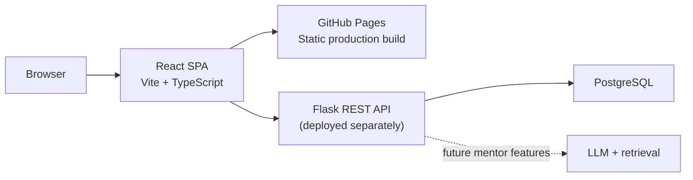

# ExamMate AI Architecture

## Product

ExamMate AI is a student-focused platform for learning software development, practicing coding, building projects, preparing for interviews, and tracking placement progress.

## Current implementation

The frontend is a React single-page application in `frontend-react/`. It is built with React 18, TypeScript, Vite, Tailwind CSS, and React Router 6. The Flask API is implemented in `backend/`; it provides authentication, health, and student-progress endpoints. GitHub Pages hosts only the static frontend, so the API must be deployed separately for online accounts and shared data.

The frontend supports local-storage demo mode when the API is unavailable. Production authentication and shared progress require a deployed Flask API and a persistent PostgreSQL database. AI integration is still planned.



## Frontend routes

| Route | Page |
| --- | --- |
| `/` | Home |
| `/about` | About |
| `/login` | Login |
| `/register` | Registration |
| `/dashboard` | Student dashboard |
| `/career-paths` | Career paths |
| `/learn` | Learning hub |
| `/practice` | Coding practice |
| `/projects` | Projects |
| `/placement` | Placement preparation |
| `/assessment` | Assessments |
| `/performance` | Progress and performance |
| `/profile` | Profile settings |
| `/contact` | Contact |

The dashboard's responsive layout and views are implemented in `frontend-react/src/pages/DashboardPage.tsx` and `frontend-react/src/components/dashboard/`.

## Technology

| Layer | Current or planned technology |
| --- | --- |
| Frontend | React 18, TypeScript, Vite, Tailwind CSS, React Router 6 |
| Backend | Python, Flask, REST API |
| Database | PostgreSQL for deployment; SQLite fallback for local development |
| AI (planned) | LLM API with retrieval-augmented generation (RAG) |

## Repository layout

```text
.
├── .github/workflows/main.yml   # GitHub Pages build and deployment
├── docs/architecture.md         # This document
└── frontend-react/
    ├── public/                  # Static images and icons
    └── src/
        ├── components/          # Shared UI and dashboard views
        ├── pages/               # Route-level screens
        └── types/               # Shared TypeScript types
```

## Local development

Run these commands from the repository root:

```bash
cd frontend-react
npm ci
npm run dev
```

Vite prints the local URL, normally `http://localhost:5173/`. Use Vite rather than a static “Go Live” server because the app uses TypeScript and JSX modules.

Build and type-check the production app with:

```bash
npm run build
```

## GitHub Pages deployment

The workflow in `.github/workflows/main.yml` runs on pushes to `main` and manual dispatch:

1. Installs the frontend dependencies with `npm ci`.
2. Reads the Pages base path from `actions/configure-pages` and passes it to Vite.
3. Builds the React app and copies `dist/index.html` to `dist/404.html` for client-side route fallback.
4. Publishes `frontend-react/dist`.

To connect the deployed frontend to a hosted API, set the GitHub Actions repository variable `VITE_API_BASE_URL` to the API URL ending in `/api/v1` (for example, `https://your-service.onrender.com/api/v1`). Configure the backend's `CORS_ORIGINS` to the GitHub Pages origin, such as `https://buildwithsitu.github.io` (without a path). Keep database credentials and `SECRET_KEY` only in the backend host's environment variables.

`HashRouter` keeps client-side routes working on static hosting, and Vite's `BASE_URL` supports both a repository subpath and a custom Pages domain.

## Planned service architecture

The browser app calls the Flask REST API for authentication and progress when it is deployed. The API owns authentication, authorization, validation, and persistence; secrets must remain server-side.

Planned service areas:

- **Accounts and profiles:** registration, login, student profile, and career goals.
- **Learning and career paths:** roadmaps, resources, and student progress.
- **Practice and assessments:** questions, attempts, timed tests, and results.
- **Analytics:** accuracy, milestones, and areas to review.
- **AI mentor:** contextual hints, recommendations, and evaluation using approved learning content.

PostgreSQL is the planned relational database. A vector-search extension may be added if the AI mentor requires retrieval over course materials. Neither the database nor API is implemented yet.

## Development roadmap

1. **Product foundation:** architecture, design system, React frontend, and core experience.
2. **Functional platform:** authentication, student profiles, learning paths, practice, projects, and progress.
3. **Backend and database:** Flask APIs, PostgreSQL, authorization, and data management.
4. **AI integration:** ExamMate AI Mentor, personalized recommendations, and AI-based evaluation.
5. **Business features:** subscriptions, payments, usage limits, and admin tools.
6. **Launch:** beta testing, feedback, performance improvements, and public launch.

