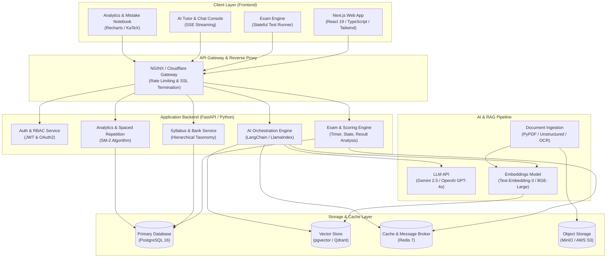
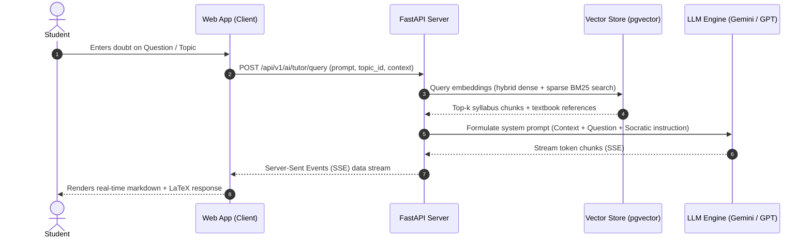
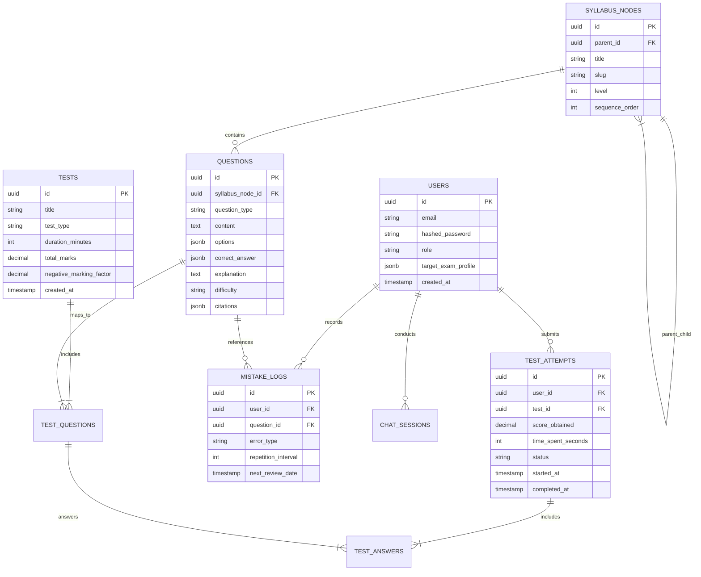

# System Architecture & Technical Design

## 1. High-Level Architecture Overview

The **AI Exam Preparation Platform** employs a modern, decoupled microservices/modular monolith architecture designed for high availability, low-latency test simulations, and high-throughput AI orchestration.

---

## 2. Tech Stack Recommendations

| Component | Technology | Rationale |
| :--- | :--- | :--- |
| **Frontend Framework** | **Next.js 15+ (React 19, TypeScript)** | High performance, Server-Side Rendering (SSR) for syllabus/SEO, App Router, rapid layout composition. |
| **Styling & UI Kit** | **Tailwind CSS + shadcn/ui** | Clean, accessible, highly customizable component library with built-in dark/light mode. |
| **Formula & Code Rendering** | **KaTeX + PrismJS / Monaco** | Ultra-fast LaTeX mathematical formula typesetting and code syntax highlighting. |
| **Backend Framework** | **FastAPI (Python 3.12)** | Asynchronous high-performance web framework; native interoperability with AI/ML, NumPy, LangChain, and PyTorch. |
| **Relational Database** | **PostgreSQL 16** | Robust ACID compliance for user accounts, exams, questions, and test attempt submissions. |
| **Vector Database** | **pgvector (or Qdrant)** | Vector similarity search for RAG over syllabus textbooks and PYQs. |
| **Cache & Task Queue** | **Redis 7 + Celery / ARQ** | Fast session state storage, test attempt synchronization, rate limiting, and background document parsing. |
| **Object Storage** | **S3-compatible (MinIO / AWS S3)** | Storage for textbook PDFs, diagram images, and exported test reports. |

---

## 3. RAG Pipeline Architecture

---

## 4. Database Schema Design (Entity-Relationship Overview)

---

## 5. API Route Specification

### Authentication & User
- `POST /api/v1/auth/register`: Create a new user account.
- `POST /api/v1/auth/login`: Authenticate and issue JWT access/refresh tokens.
- `GET /api/v1/auth/me`: Fetch authenticated user profile and exam targets.

### Syllabus & Question Bank
- `GET /api/v1/syllabus/tree`: Retrieve hierarchical syllabus tree.
- `GET /api/v1/questions?topic_id={id}&difficulty={level}`: Fetch filtered questions.
- `POST /api/v1/questions/generate`: Trigger AI generation of targeted questions by syllabus subtopic.

### Mock Tests & Examination
- `GET /api/v1/tests`: List available mock tests.
- `POST /api/v1/tests/{id}/start`: Initialize a test attempt session, returning initial questions and timer token.
- `PUT /api/v1/tests/attempts/{attempt_id}/save`: Autosave candidate response for question $k$.
- `POST /api/v1/tests/attempts/{attempt_id}/submit`: Conclude test, compute marks, negative penalties, and percentile.

### AI Tutor & RAG
- `POST /api/v1/ai/tutor/chat`: Stream Socratic explanations and step-by-step guidance.
- `POST /api/v1/ai/explain-question`: Generate targeted breakdown for a missed question.

### Analytics & Spaced Repetition
- `GET /api/v1/analytics/dashboard`: Aggregate student mastery by subject and topic.
- `GET /api/v1/analytics/mistakes`: Retrieve questions due for revision under the SM-2 spaced repetition schedule.

---

## 6. Security, Resilience & Scalability Measures
1. **Deterministic Test State**: All test progress autosaves every 15 seconds to Redis; crashes or page reloads seamlessly recover the exact state without loss of time.
2. **LLM Cost & Rate Guardrails**:
   - Token usage budgeting per user tier.
   - Semantic response caching in Redis for identical conceptual queries.
3. **Containerized Microservices**: All tiers built as stateless Docker containers orchestrated via Docker Compose for local development and Kubernetes/Cloud Run for production.

